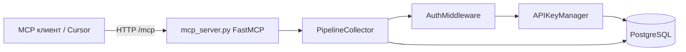

# Pipeline MCP Server

MCP-сервер для чтения пайплайнов из PostgreSQL: проекты, списки пайплайнов, граф узлов и экспорт в формате, удобном для LLM. Доступ к данным привязан к пользователю через API-ключ; в ответах MCP не отдаются внутренние id сущностей БД и персональные данные.

## Требования

- **Python** 3.14+ (см. `.python-version`)
- **PostgreSQL** 18 (или совместимая версия)
- **Docker** и **Docker Compose** — для быстрого поднятия БД и сервера (рекомендуется)
- Менеджер зависимостей: [uv](https://docs.astral.sh/uv/) или `pip`

## Быстрый старт (Docker)

Из корня репозитория:

```bash
docker compose up --build
```

Поднимаются два сервиса:

| Сервис       | Порт  | Назначение                                      |
|-------------|-------|-------------------------------------------------|
| `db`        | 5432  | PostgreSQL с дампом `test_brainiac.sql`         |
| `mcp-server`| 8000  | MCP по HTTP: `http://localhost:8000/mcp`        |

После старта БД уже содержит тестового пользователя `test_user@example.com`, проект `time_manager` и пайплайн `schedule_agent`. **Готового plaintext API-ключа в дампе нет** (в БД только хэши). Создайте ключ через [консоль `test.py`](#консоль-для-отладки-testpy) или SQL/скрипт с `APIKeyManager.create_api_key`.

Проверка, что сервер слушает:

```bash
curl -s -o /dev/null -w "%{http_code}" http://127.0.0.1:8000/mcp
```

(код ответа зависит от метода MCP; главное — нет ошибки соединения.)

Остановка:

```bash
docker compose down
```

Данные PostgreSQL сохраняются в volume `postgres_data`. Чтобы пересоздать БД с нуля: `docker compose down -v`, затем снова `up`.

## Поддержка ветвлений и портов

Граф пайплайна поддерживает узел-разветвитель **`branch`** (исходы: да / нет / ошибка) и несколько входов/выходов у блока, описанных в `tools.config`. Связи (`links`) хранят `source_handle` / `target_handle` — порт, из которого выходит и в который входит ребро. MCP-инструменты (`get_pipeline_structure`, `export_pipeline_as_code`, `export_for_llm`) отдают эти данные как `ports`, `connections[].from_port`/`to_port` и план выполнения с ветвлениями `execution_plan`.

Для БД, созданных до появления этих полей, примените миграцию:

```bash
psql -U postgres -d test_brainiac -f migrations/002_link_handles_and_branch_type.sql
```

## Экспорт пайплайна в код (автоматизация для агента)

Пользователю достаточно **подключить MCP** и написать, например: «Экспортируй пайплайн schedule_agent кодом, проект time_manager».

Агент должен вызвать **`export_pipeline_as_code`** — в ответе:

- **`pipeline_spec`** — данные пайплайна (как `export_for_llm`);
- **`workflow`** — инструкции skill (скачивание skill вручную не обязательно).

Дополнительно на сервере:

- **instructions** сервера — подсказка агенту использовать `export_pipeline_as_code`;
- **resource** `skill://pipeline-to-code` — текст skill;
- **prompt** `export_pipeline_as_code` — готовый шаблон запроса в UI MCP.

Тексты skills хранятся в `cursor_skills/` и отдаются через MCP (пересборка образа: `docker compose up --build`).

## Локальный запуск (без Docker для MCP)

### 1. База данных

Либо только БД в Docker:

```bash
docker compose up db -d
```

Либо свой экземпляр PostgreSQL с загруженным `test_brainiac.sql`.

### 2. Конфигурация

Скопируйте и при необходимости отредактируйте `config.env` в корне проекта:

```env
user=postgres
password=7474
database=test_brainiac
host=localhost
port=5432
```

Для MCP-сервера дополнительно (в `config.env` или переменных окружения):

| Переменная      | По умолчанию        | Описание                          |
|-----------------|---------------------|-----------------------------------|
| `MCP_HOST`      | `0.0.0.0`           | Хост HTTP-сервера                 |
| `MCP_PORT`      | `8000`              | Порт                              |
| `MCP_TRANSPORT` | `streamable-http`   | Транспорт MCP (`stdio` — для IDE) |

### 3. Зависимости

С **uv** (из корня репозитория):

```bash
uv sync
```

Или вручную:

```bash
pip install asyncpg dotenv mcp uvicorn
```

### 4. Запуск MCP

Рабочая директория — `src/` (импорты модулей рассчитаны на это):

```bash
cd src
python mcp_server.py
```

Эндпоинт: **`http://127.0.0.1:8000/mcp`** (Streamable HTTP).

Для транспорта stdio (некоторые MCP-клиенты):

```bash
set MCP_TRANSPORT=stdio
python mcp_server.py
```

## Подключение в Cursor

В настройках MCP добавьте сервер, например:

```json
{
  "mcpServers": {
    "pipeline-mcp": {
      "url": "http://127.0.0.1:8000/mcp"
    }
  }
}
```

Убедитесь, что `mcp-server` запущен и порт `8000` свободен. Во всех tools первым аргументом передаётся **`api_key`** — ключ, созданный для вашего пользователя в БД.

## Как это устроено



1. **`mcp_server.py`** + **`mcp_app/`** — [MCP Python SDK](https://github.com/modelcontextprotocol/python-sdk): `FastMCP`, `lifespan` (пул БД на старте/остановке), tools с `Context[AppContext]`.
2. **`db_folder/db_connection.py`** — пул **asyncpg**, методы `fetch` / `fetch_one` / `execute`.
3. **`api_folder/api_module.py`** — генерация и проверка API-ключей (PBKDF2, префикс `tm_…`), привязка к `users`.
4. **`pipline_folder/auth_middleware.py`** — аутентификация по ключу; при ошибке — `InvalidApiKeyError`.
5. **`pipline_folder/pipeline_collector.py`** — бизнес-логика: проекты, пайплайны, граф `nodes` + `links`, экспорт для LLM, обход графа `execution_sequence_walk`.
6. **`json_utils.py`** — приведение `Decimal` и `timedelta` к JSON-совместимым значениям.

### Модель данных (упрощённо)

- **users** — владельцы данных.
- **api_keys** — ключи доступа (хранится хэш, не сам ключ).
- **projects** — проекты пользователя (`name`).
- **pipelines** — пайплайны внутри проекта (`name`, лимиты, `report`).
- **nodes** — шаги пайплайна (тип, инструмент, попытки).
- **links** — рёбра графа `from_node` → `to_node`.
- **node_types**, **tools** — справочники типов шагов и инструментов.

Запросы всегда фильтруются по `user_id`, полученному после проверки API-ключа.

### Слоты шагов (`step_slot`)

Внутренние id узлов в ответах MCP **не отдаются**. Вместо этого узлам присваиваются стабильные номера **1…N** по возрастанию id в БД. Связи описываются как `from_step` / `to_step` с портами `from_port` / `to_port`. Экспорт **`export_version: 2`** включает полные настройки блоков (`node_config`, `ports`, `tool_config`), вложенные пайплайны (`nested_pipelines`) и план выполнения с ветвлениями (`execution_plan`).

Если по паре `(project_name, pipeline_name)` в БД несколько записей, возвращается **ошибка** — нужна уникальность имён в рамках проекта.

## MCP tools

| Tool | Назначение |
|------|------------|
| `get_projects` | Список имён проектов текущего пользователя |
| `get_pipelines` | Список пайплайнов (метаданные без id); опционально фильтр `project_name` |
| `search_pipelines` | Поиск пайплайнов по подстроке имени (`ILIKE`) |
| `get_pipeline_structure` | Граф v2: blocks с `node_config`/ports, connections с портами, statistics |
| `export_pipeline_as_code` | Спецификация v2 + workflow для генерации кода (основной сценарий) |
| `export_for_llm` | JSON v2: `blocks`, `connections`, `execution_plan`, `nested_pipelines`, `limits` |
| `get_pipeline_flow` | `execution_sequence` с `node_config` для указанного пайплайна |

Во всех tools: **`api_key`** (строка). Для структуры и экспорта также **`project_name`**, **`pipeline_name`** (точное совпадение с БД).

Пример тестовых имён после загрузки дампа: проект `time_manager`, пайплайн `schedule_agent`.

## Структура репозитория

```
my-mcp/
├── config.env              # учётные данные БД и MCP
├── docker-compose.yml      # PostgreSQL + MCP
├── Dockerfile
├── test_brainiac.sql       # схема и тестовые данные
├── migrations/
│   └── 002_link_handles_and_branch_type.sql
├── cursor_skills/           # skills, отдаются через MCP (resource skill://...)
├── pyproject.toml
└── src/
    ├── mcp_server.py       # точка входа
    ├── mcp_app/            # SDK: config, lifespan, tools, views
    ├── json_utils.py
    ├── test.py             # консоль для ключей и отладки
    ├── test_db.py          # проверка подключения к БД
    ├── config.env          # конфиг для test.py / test_db.py (запуск из src/)
    ├── api_folder/
    │   └── api_module.py
    ├── db_folder/
    │   └── db_connection.py
    └── pipline_folder/
        ├── auth_middleware.py
        ├── pipeline_collector.py
        ├── graph_export.py
        ├── graph_executor.py
        ├── graph_slots.py
        ├── pipeline_interface.py
        └── port_schema.py
```

## Консоль для отладки (`test.py`)

Интерактивное меню: создание API-ключа, список пайплайнов, структура по id, экспорт в JSON, список и отзыв ключей.

```bash
cd src
python test.py
```

Пункт **«Создать API ключ»** — укажите email `test_user@example.com`, сохраните выданный ключ (`tm_…`) для вызовов MCP tools.

> `test.py` работает с внутренними id пайплайнов; MCP tools используют **имена** проекта и пайплайна.

## Переменные в Docker Compose

В `docker-compose.yml` для сервиса `mcp-server` переопределяются:

- `host=db` — имя сервиса PostgreSQL в сети compose
- `MCP_TRANSPORT=streamable-http`, `MCP_PORT=8000`

Локально в `config.env` оставьте `host=localhost`, если БД на хосте.

## Дополнительно

Подробности недавних доработок (слоты, приватность, единый обход графа): [`MCP_IMPROVEMENTS_REPORT.md`](MCP_IMPROVEMENTS_REPORT.md).

## Устранение неполадок

| Симптом | Что проверить |
|---------|----------------|
| Не подключается к БД | `host`/`port`, что PostgreSQL запущен, совпадение `user`/`password`/`database` с `config.env` |
| `Invalid API key` | Ключ создан для существующего пользователя, не отозван (`is_active`) |
| `Pipeline not found` | Точные `project_name` и `pipeline_name`, пайплайн принадлежит пользователю ключа |
| Порт 8000 занят | Смените `MCP_PORT` и проброс в `docker-compose.yml` |
| Пустой проект после `up` | Первый запуск: дождитесь healthcheck БД; при сбое init пересоздайте volume (`down -v`) |
